# Hi, I'm Sampedro 👋

### Computer Science student · Python · Web automation

Building practical tools, learning by doing, and sharing what I learn.

---

## About me

- 🎓 Studying **Software Architecture** (7th semester).
- 🐍 Building web automation and scraping projects with **Python** and **Playwright**.
- 🌱 Interested in software design, automation, and continuous learning.
- 🙏 Guided by the idea that true greatness is found in serving others.

## Tools I work with

  
  
  

## A thought I try to live by

> “If anyone wants to be first, he shall be last of all and servant of all.”
>
> — Mark 9:35

